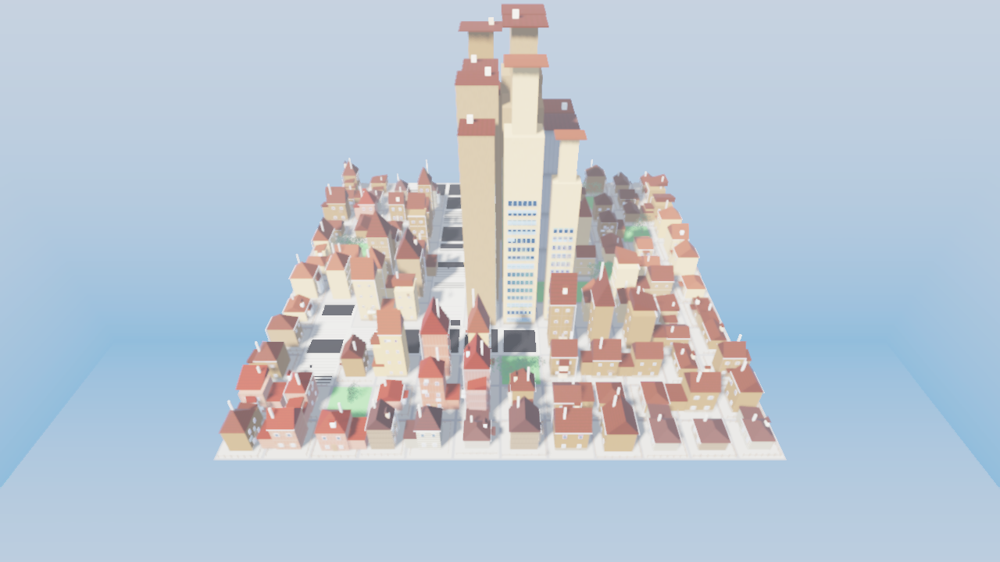
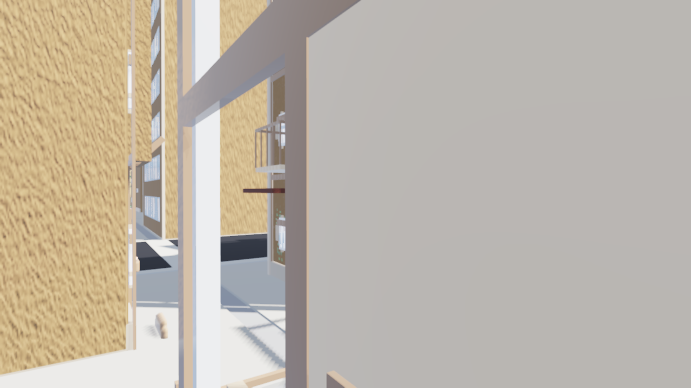
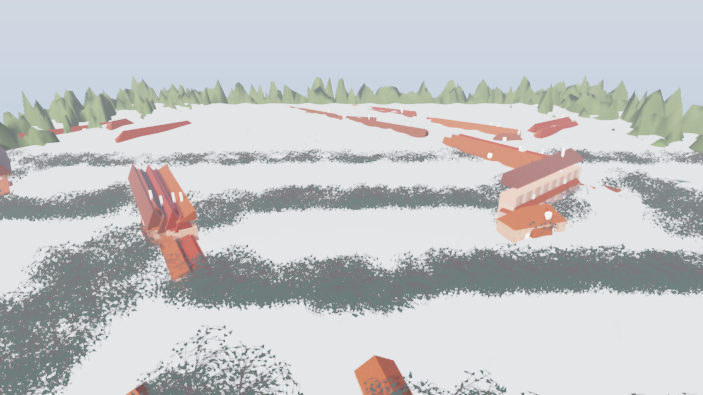
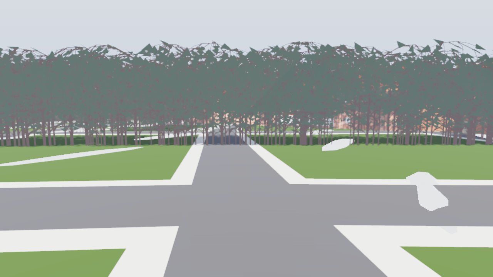

# Tutorial G31 — World generator helper (landscape or city)

> 🇩🇪 **Deutsche Version:** [docs/de/tutorials/g31_worldgen.md](../../de/tutorials/g31_worldgen.md)

**Goal:** generate a complete procedural **landscape** or **city** with one function call:
`procedural::generateWorld(params)` in `procedural/worldgen.hpp`. One parameter struct
(`WorldGenParams`) switches the mode; the result (`GeneratedWorld`) is plain CPU data —
heightmap, WFC placements, `MeshData`, placed meshes — that you attach to a `scene::Scene`.
Deterministic per seed, no GL needed for generation.

## Usage

```cpp
#include <fuhglgraphics/procedural/worldgen.hpp>

using fuhglgraphics::procedural::WorldGenParams;
using fuhglgraphics::procedural::generateWorld;

WorldGenParams p;
p.mode = WorldGenParams::Mode::Landscape;   // or Mode::City
p.seed = 777;
const auto world = generateWorld(p);
```

## Landscape mode

```cpp
WorldGenParams p;
p.mode = WorldGenParams::Mode::Landscape;
p.seed = 777;
p.worldSize = 200.f;        // X/Z extent in world units (centered at the origin)
p.terrainGrid = 129;        // heightmap resolution
p.terrainHeight = 34.f;     // height scale (heightmap itself is stored in [0,1])
p.noiseScale = 0.045f;      // noise-space scale per world unit
p.octaves = 6;              // fBm octaves of the plains layer
p.warpStrength = 0.6f;      // domain warp of the noise input (0 = off)
p.heightExponent = 0.85f;   // contrast shaping pow(h, exponent); <1 -> more pronounced peaks
p.waterLevel = 0.30f;       // >0: water/lake at this normalized level
p.lakeRadius = 55.f;        // >0: round lake basin of this radius around the center
p.lakeCarve = 0.18f;         // basin depth factor below the water level
p.erosionDroplets = 4000;   // hydraulic erosion: droplet particle sim (0 = off)
p.thermalPasses = 4;        // thermal erosion passes (0 = off)
p.talus = 0.09f;             // thermal talus threshold (normalized height drop per cell)
p.treeCount = 130;          // scattered L-system trees (poisson-disk, grass-weighted)
p.bushCount = 180;          // scattered bushes
p.rockCount = 60;           // scattered rocks (splatmap rock mask)
p.grassBlades = 6000;       // hint for the app: instanced grass via Instancing::heightFn
p.treeMinDist = 6.f;        // poisson-disk min distance

const auto w = generateWorld(p);
w.heightmap;                // gridW*gridH floats, row-major (x + gridW*z), [0,1]
w.heightAt(x, z);           // world-space bilinear height (sample * heightScale, clamped)
w.waterLevelWorld;          // water level in world units (place a WaterComponent here)
w.splatmap;                 // gridW*gridH RGBA weights: R grass, G rock, B sand, A snow
w.flowmap;                  // gridW*gridH float [0,1]: hydraulic flow accumulation (riverbeds)
w.trees;                    // PlacedMesh: mesh (L-system tree) + position/rotY/scale/tint
w.bushes;                   // PlacedMesh: bushes, same placement rules
w.rocks;                    // PlacedMesh: sphere rocks on steep/rock splatmap areas
```

### Landscape pipeline (what `generateLandscape` does)

1. **Macro relief** — one heightmap from combined layers: domain warping of the noise input
   (`warpStrength`), a very low-frequency *continentalness* simplex mask that selects plains
   (fBm) vs. mountain ranges (*ridged* multifractal, sharp crests), `pow(h, heightExponent)`
   contrast shaping, the round `lakeRadius` basin and an island falloff at the border.
2. **Erosion** — `erosionDroplets` virtual droplets run downhill on the heightmap, picking up and
   depositing sediment (hydraulic erosion carves valleys/riverbeds and fills `flowmap`), then
   `thermalPasses` relax every slope steeper than the `talus` angle into debris fans (thermal
   erosion).
3. **Splatmap** — per cell: G rock from the world-space slope (band relative to the steepest
   slope present, so cliffs get rock at any heightScale/grid combination), A snow from altitude
   (`smoothstep(0.58, 0.8, h)`), B sand near the water level plus `flowmap` riverbeds, R grass as
   the remainder. Upload `splatmap` as an RGBA texture and use it as the terrain splat map.
4. **Meshing & LOD** — build a grid `MeshData` from `heightmap` (uv = grid uv, so the splatmap
   maps 1:1 onto the cells). For big worlds use `scene::TerrainComponent` instead: it wraps the
   same heightmap in a `LodMesh` (F38/F41 quadtree-style LOD with screen-space switch distances) —
   copy `w.heightmap` into `TerrainComponent::heights` and call `rebuildLod()`; triplanar mapping
   for steep cliffs lives in the terrain shader (shader-side).
5. **Scattering** — poisson-disk sampling (dart throwing with a spatial hash, guaranteed
   `treeMinDist`) weighted by the splatmap: trees/bushes on grass above the water line, rocks on
   the rock mask. Grass itself is app-side GPU instancing (`Node::instancing`) with a `heightFn`
   that snaps blades to `heightAt` and hides them under water / on rock-snow-sand texels
   (density mask).

Attach it to a scene (terrain grid mesh with the splatmap as albedo texture, or
`TerrainComponent` + splatmap shader; trees/bushes/rocks → one node each; grass → one instanced
node):

```cpp
scene::Scene scene;
scene::Node& tn = scene.root().createChild("terrain");
fuhgl::render::Mesh terrainMesh;
terrainMesh.setMeshData(terrainMeshData(w)); // grid from w.heightmap, uv = grid uv
auto& te = tn.attach<scene::MeshComponent>().addMesh(&terrainMesh);
te.albedoTexture = &splatmapTexture;         // RGBA: R grass / G rock / B sand / A snow
for (size_t i = 0; i < w.trees.size(); ++i) {
    auto& n = scene.root().createChild("tree" + std::to_string(i));
    n.translation = w.trees[i].position;
    n.rotation = fuhgl::math::fromAxisAngle(w.trees[i].rotY, {0, 1, 0});
    n.scale = {w.trees[i].scale, w.trees[i].scale, w.trees[i].scale};
    auto& e = n.attach<scene::MeshComponent>().addMesh(treeMeshes[i]); // Mesh::setMeshData(...)
    e.albedo = w.trees[i].tint;
}
```

See `examples/worldgen_screenshot/main.cpp` for a complete, runnable version.

## City mode

```cpp
WorldGenParams p;
p.mode = WorldGenParams::Mode::City;
p.seed = 777;
p.cityGrid = 12;            // WFC cells per side
p.cellSize = 8.f;           // world size of one cell
p.buildingHeight = 7.f;     // base wall height (jittered per block)
p.houseFootprint = 0.62f;   // house footprint as a fraction of the cell
p.blocksPerDistrict = 28;   // >0: voronoi district plates under the city
p.parkBushesPerPlaza = 3;   // bushes per plaza (park) cell

const auto w = generateWorld(p);
w.cells;                    // cityW*cityH WfcCell {tile, rot}, row-major
w.tiles;                    // tile set (w.cells[].tile indexes into it)
w.cityGround;               // MeshData base plate (top at y = 0)
w.roads;                    // merged slabs: sidewalk + dark asphalt (streets), concrete lots, park lawns
w.districts;                // voronoi plates (empty when blocksPerDistrict == 0)
w.buildings;                // one procedural house per non-park "block" cell, three mesh parts:
                            // mesh = walls (attach the brick POM set here), detailMesh = door/windows/
                            // chimney/bay window (plain vertex colors), roofMesh = roof
                            // (roofType: 0 = gable/Satteldach, 1 = lean-to/Schleppdach, 2 = flat);
                            // styles: Village (bay window + chimney), Town (windows per floor),
                            // Highrise (window grid + setback + flat roof)
w.bushes;                   // park greenery on plaza cells
```

The layout is a G27 WFC solve over `makeCityTiles()` — edge tags `"r"` (road), `"s"`
(lot/sidewalk, also the border tag) and `"p"` (plaza); tile names `block`, `plaza`, `streetH`,
`streetV`, `cross`, `tE`, `endE` with rotations handled by the solver. Street/plaza cells become
merged road slabs, `block` cells become building boxes with per-block height/tint jitter.

## HouseGenerator class (variadic houses)

For full control over individual houses use `procedural::HouseGenerator` in
`procedural/house.hpp` directly — `generateWorld` uses it internally for the city blocks:

```cpp
fuhglgraphics::procedural::HouseGenerator gen;
auto p = fuhglgraphics::procedural::HouseGenerator::randomParams(
    fuhglgraphics::procedural::HouseStyle::Village, /*cellSize=*/8.f, /*seed=*/123u);
const auto house = gen.generate(p);
// house.walls    -> facade (attach the brick POM set here)
// house.details  -> door/windows/chimney/bay/dormers/timber frame (plain vertex colors)
// house.roof     -> roof solid; house.spec.roofType = Gable | Shed | Hipped | Flat
// house.spec     -> which variants fired (hasBay, hasDormers, hasAnnex, hasPorch, ...)
```

Variants: roof types gable (Satteldach), lean-to (Schleppdach), hipped (Walmdach), flat;
features bay window (Erker), dormers (Dachgauben), side annex (Anbau), porch canopy (Vordach),
chimney, timber framing (Fachwerk); highrise style adds a facade window grid + setback + flat
roof. Deterministic per seed; unit tests in `tests/test_procedural_house.cpp`.

## Pipeline city generator (terrain -> roads -> lots -> houses)

`procedural::generateCityWorld(CityGenParams)` in `procedural/citygen.hpp` implements the full
pipeline as separate, unit-testable stages:

1. **Terrain & zones**: fBm heightmap with a flattened city plateau and a lake below
   `waterLevel`; zone grids `density` (city center -> highrises, rim -> village) and `wealth`
   from independent noise layers (`CityWorld::heightAt/densityAt/wealthAt`).
2. **Road network**: a noise-warped street grid stored as a planar graph (`RoadGraph`: nodes =
   intersections, edges = segments); nodes under water are dropped. Rendered as
   sidewalk+asphalt quads into `CityWorld::roadMesh`.
3. **Lot subdivision**: each surviving grid cell is a block polygon, recursively OBB-split
   (half-plane split along the longest PCA axis, self-contained `clipHalfPlane`/`computeObb`)
   into lots; `earClip` triangulates the lot slabs (`lotMesh`). Boundary-touching lots get road
   access, interior lots become parks.
4. **Buildings**: per accessible lot a `HouseGenerator` house whose style comes from the
   density zone (Village/Town/Highrise); park lots get bushes.

No external polygon library is used (ear clipping, half-plane clip and OBB/PCA are implemented
in `citygen.cpp`). Performance notes for the app side: merge static city geometry into few
meshes (as the demo does), keep facade POM on the walls only, and use LOD/instancing for
repeated modules. Unit tests: `tests/test_procedural_citygen.cpp`.

```cpp
procedural::CityGenParams p;
p.seed = 777;
const auto city = procedural::generateCityWorld(p);
// city.heightmap -> TerrainComponent, city.roadMesh/city.lotMesh -> nodes,
// city.houses -> PlacedMesh list (walls POM + details + roof)
```

## Screenshot demo

`examples/worldgen_screenshot` renders all modes headless to PNG (CI renders
`docs/images/ci/g31_worldgen_{landscape,city,city_street}.png` and
`docs/images/ci/g31_pipeline{,_street}.png`, compressed with optipng; checked-in references in
[docs/images/](../../images/g31_worldgen_city.png)):

```bash
cmake --build build --target fuhglgraphics_worldgen_screenshot
FUHGL_BACKEND=surfaceless ./build/examples/fuhglgraphics_worldgen_screenshot \
    --prefix g31_worldgen --width 1280 --height 720 --frames 16 --seed 777 --mode both
FUHGL_BACKEND=surfaceless ./build/examples/fuhglgraphics_worldgen_screenshot \
    --prefix g31_pipeline --width 1280 --height 720 --frames 16 --seed 777 --mode pipeline
# writes g31_worldgen_{landscape,city,city_street}.png and g31_pipeline{,_street}.png
```







## Tests

- `tests/test_procedural_worldgen.cpp` (unit): heightmap size/range/border/lake, `heightAt`
  sampling + clamping, erosion (droplets lower the peaks, flowmap stays in [0,1]), splatmap
  channels (grass/rock/sand/snow present and in range), poisson scatter (min distance, rocks on
  the rock mask, determinism per seed), tree placement rules (on terrain, out of the lake, min
  distance), WFC layout validity incl. border tags, block→building mapping, mode dispatch.

## Notes

- Same seed → identical world on every platform (the generators are the seeded G24-G28 modules).
- Generation is pure CPU; only `Mesh::setMeshData` upload needs a GL context.
- For full control over the city tile set, pass your own tiles to `procedural::Wfc` directly
  (see [G27](g27_wfc.md)); `makeCityTiles()` is just the ready-made set used by `generateWorld`.
