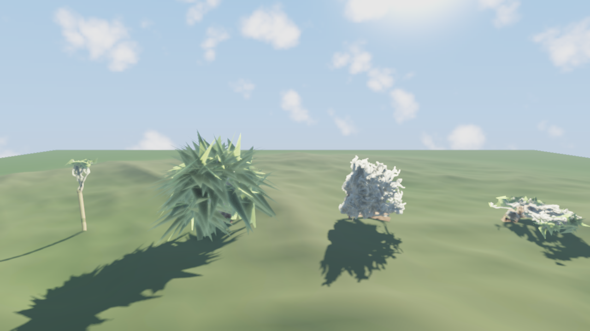
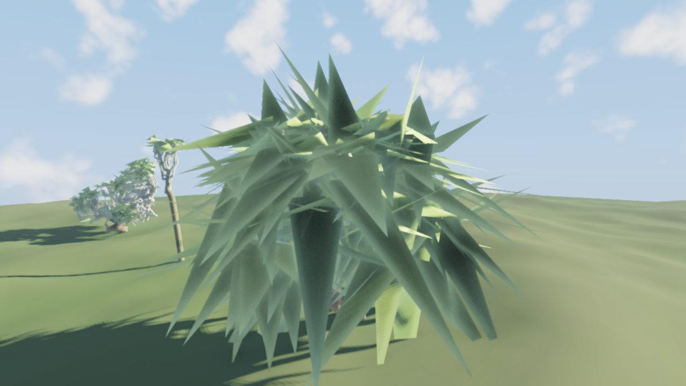

# Tutorial G37 — ecophysiological vegetation generator

> 🇩🇪 **Deutsche Version:** [docs/de/tutorials/g37_vegetation.md](../../de/tutorials/g37_vegetation.md)

**Goal:** grow biologically plausible plants from *environmental parameters* — the same
`temperature`/`humidity` values the G31 world generator computes per terrain cell, plus wind
exposure and stand density. `procedural::VegetationGenerator` (`procedural/vegetation.hpp`)
runs the Space Colonization Algorithm toward light attractors, applies climate-to-geometry
rules, sizes branch radii by the Da Vinci pipe model and bakes leaf/bark tints into the vertex
colors. Design doc: [docs/VEGETATION_GENERATION.md](../../VEGETATION_GENERATION.md).

## Usage

```cpp
#include <fuhglgraphics/procedural/vegetation.hpp>

using namespace fuhglgraphics::procedural;

// 1. environment — same parameter space as the G31 terrain/buildings climate maps
EcoEnvironment eco;
eco.temperature   = 0.85f;            // [0,1]: 0 cold/snowy .. 1 warm/frost-free
eco.humidity      = 0.90f;            // [0,1]: 0 dry .. 1 very wet (tropics)
eco.windExposure  = 0.2f;             // [0,1]: 0 sheltered .. 1 coast/peak
eco.windDir       = {1.f, 0.f, 0.f};  // direction the wind blows toward
eco.standDensity  = 0.1f;             // [0,1]: 0 lone tree .. 1 dense forest
eco.season        = 0.f;              // [0,1]: 0 summer .. 1 late autumn (leaf colors)
eco.seed          = 42u;

// 2. generate (pure CPU, deterministic per seed)
VegetationGenerator gen;
VegetationParams p = VegetationGenerator::randomParams(eco, eco.seed);
p.scale = 1.2f;
const VegetationMesh plant = gen.generate(p);
// plant.branches / plant.leaves: MeshData (11 floats/vertex; uv.x = age/radius,
// uv.y = wet-side factor, vertex colors = baked tints); plant.material = shader params;
// plant.height, plant.form (the derived GrowthForm: leaf morphology, crown, droop, ...)

// 3. upload + place (needs a GL context); leaves as their own entry get G33 SSS backlighting
fuhgl::render::Mesh branchMesh, leafMesh;
branchMesh.setMeshData(plant.branches);
leafMesh.setMeshData(plant.leaves);
scene::Node& n = scene.root().createChild("tree");
n.translation = {x, terrain.heightAt(x, z), z};
scene::MeshEntry& be = n.attach<scene::MeshComponent>().addMesh(&branchMesh);
be.roughness = 0.9f;
scene::MeshEntry& le = n.attach<scene::MeshComponent>().addMesh(&leafMesh);
le.roughness = 0.75f;
le.subsurface = plant.material.sss;   // thin leaves glow when backlit (Effect::Subsurface)
```

## What the environment changes

| Input | Effect |
|---|---|
| `standDensity` → 1 | light attractors concentrate at the top → tall straight trunk, lower branches self-prune, small top crown (rainforest); at 0 → broad spreading crown (old oak) |
| `humidity` > 0.72 | huge thin leaves with drip tips (rain runs off) |
| `humidity` < 0.28 | small thick waxy leaves; < 0.12 warm → thorns / succulent fat trunk, no leaves |
| `temperature` < 0.32 | needle tree, conical crown, drooping branches (snow slides off) |
| `windExposure` → 1 | constant wind vector on the growth direction, max height −55%, crooked flagged tree / flat ground cover |
| `season` → 1 (or very dry) | chlorophyll ramp in the leaf tint: green → yellow → orange → red-brown |

The Space Colonization stage (`spaceColonization`) and the pipe model (`applyPipeModel`,
R² = Σ rᵢ² per fork) are also usable standalone on a `GrowthForm` from `deriveGrowthForm(eco)`.

## Demo + result

`examples/vegetation_showcase` — six plants from six environments side by side on a G24-noise
terrain (meadow oak, dense-forest column, tropical drip-tip, desert succulent, wind-flagged
coastal tree, autumn tree), low sun, CSM shadows, sky cubemap + IBL, and `Effect::Subsurface`
so the backlit leaves glow:

```bash
cmake --build build --target fuhglgraphics_vegetation_showcase
FUHGL_BACKEND=surfaceless ./build/examples/fuhglgraphics_vegetation_showcase \
    --prefix docs/images/g37_vegetation --width 1280 --height 720 --frames 16
# -> docs/images/g37_vegetation_wide.png, g37_vegetation_driptip_closeup.png
```

Unit tests: `tests/test_procedural_vegetation.cpp` (climate→geometry rule table, open vs.
dense competition, pipe-model identity, wind lean, determinism, mesh validity).




