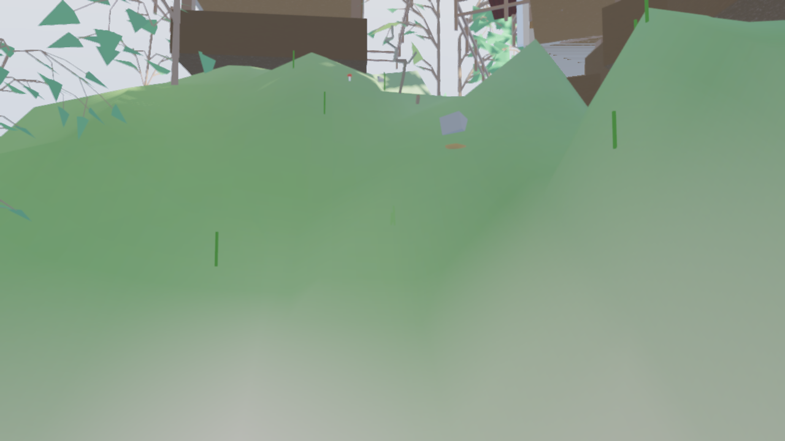
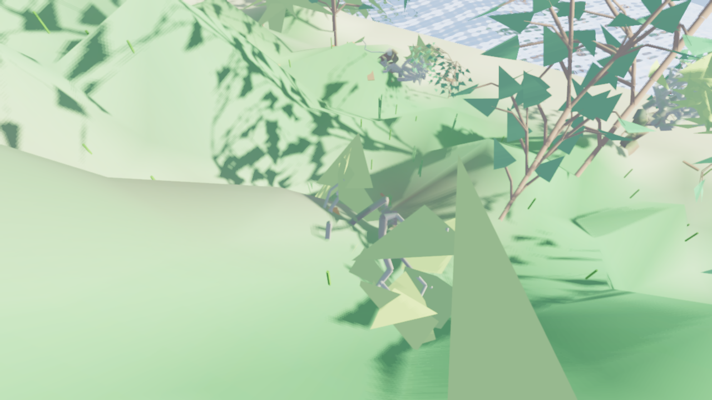

# Tutorial G39 — Ambient life: causal clutter, micro-fauna, atmospheric particles

> 🇩🇪 **Deutsche Version:** [docs/de/tutorials/g39_ambient_life.md](../../de/tutorials/g39_ambient_life.md)

**Goal:** give a procedural landscape real life. Small details must not be scattered
uniformly — they arise *causally* from the world: branches lie only under trees, pebbles only
in riverbeds, rockfall only at cliff feet. And the air moves: one shared wind field drives
grass, tree crowns and drifting particles together, so gusts sweep through the scene in order.
Two modules (design: [docs/AMBIENT_LIFE.md](../../AMBIENT_LIFE.md)):
`procedural::ClutterGenerator` (`procedural/clutter.hpp`, G39a) and the G39b sims in
`procedural/lifegen.hpp`. In the G31 landscape, `generateWorld()` already runs both:
`GeneratedWorld::clutter` holds the scattered items, `GeneratedWorld::lifeZones` the life
zones, `GeneratedWorld::windParams` the shared wind.

## G39a — causal clutter (standalone)

```cpp
#include <fuhglgraphics/procedural/clutter.hpp>

using namespace fuhglgraphics::procedural;

ClutterInput in;
in.heightmap = &world.heightmap;   // normalized [0,1], row-major x + gridW*z
in.gridW = world.gridW;  in.gridH = world.gridH;
in.sizeX = world.sizeX;  in.sizeZ = world.sizeZ;
in.heightScale = world.heightScale;
in.waterLevel = 0.30f;
in.flow = &world.flowmap;          // erosion/river flow
in.humidity = &world.humidity;     // drives mushrooms on wet north sides
in.biome = &world.biome;           // conifer biome -> cones under trees
in.roadMask = &world.roadMask;     // G38 road mask -> clutter at the frayed rim
for (const auto& t : world.trees) in.treeSpots.push_back({t.position.x, t.position.z});
in.treeRadii.assign(world.trees.size(), 3.2f);
for (const auto& b : world.buildings) in.buildingSpots.push_back({b.position.x, b.position.z});

ClutterGenParams cp;               // per-kind budgets (rockfallCount, pebbleCount, ...)
cp.seed = 42;
ClutterGenerator cg;
std::vector<ClutterItem> clutter = cg.generate(in, cp); // deterministic per seed
```

Each `ClutterItem` = `kind` (rockfall, pebble, driftwood, reed, branch, cone, bark, mushroom,
leaf pile, weed tuft, gravel, roof tile, crate) + local mesh + position/rotY/scale. Bake them
into one static mesh (apply translate·rotateY·scale per item, keep the vertex colors) — one
draw call for the whole scatter, exactly like `examples/worldgen_screenshot` does.

The causal rules, each exposed as a testable weight function:

- `rockfallWeight` — slope map (central differences): talus gathers where the world slope
  crosses `cliffSlope` (nothing in the water: `h < waterLevel+0.04` → 0).
- `riverbedWeight` — high flow + at/below the waterline → pebbles, driftwood where flow is
  very high.
- `waterlineWeight` — narrow shore band with some flow → reeds along the banks.
- `treeDistance` / building ring — parent-child litter inside each tree's radius;
  mushrooms only on the wet **north side**, humidity-weighted.
- `roadEdgeDistance` — only the frayed road-mask rim (`0.03..0.6`), never the carriageway.
- `clusterMask` — high-frequency fbm through `clusterThreshold`: nests vs. empty ground.
  Combined with weighted poisson-disk sampling (`minDist`) so nests have a minimum spacing.

## G39b — life sims and the shared wind

```cpp
#include <fuhglgraphics/procedural/lifegen.hpp>

WindField wind(world.windParams);           // echo of WorldGenParams::wind
WindFieldParams wp;                          // baseDir/baseSpeed + traveling gust front
                                              // (gustWavelength/gustSpeed) + fbm turbulence
// mirror wind.sample(x,y,z,t) in the vertex shader for grass/tree sway:
const fuhgl::math::Vec3 w = wind.sample(x, y, z, t);

BoidsSim birds;                              // BoidsParams: center/radius/count/speed...
birds.step(1.f/60.f, wind, t);               // separation + alignment + cohesion + wind

InsectSwarm midges;                          // curl-noise advection: tumbling, never colliding
midges.step(1.f/60.f, wind, t);

AmbientParticleSim particles;                // biome-mapped species via ambientKindFor(biome, hum)
particles.step(1.f/60.f, wind, t);           // pollen/seeds rise, leaves/snow sink, respawn at top
```

All sims are fixed-step and deterministic per seed — feed the positions per frame into the G5
GPU particle system or tiny instanced meshes. `generateWorld(Landscape)` already derives the
`LifeZone`s from the world data: bird flock at the lake centroid, fish school at the strongest
river flow, insect swarm over a meadow, fireflies in the wettest forest, ambient particles at a
dominant-biome cell (`ambientKindFor`: desert→sand, snow/taiga→snow dust, coast→spray,
forest→leaves/seeds, grassland→pollen).

## In the world generator

```cpp
procedural::WorldGenParams p;
p.clutterCount = 700;        // G39a cap (0 = off), knobs in p.clutterParams
p.lifeZones = true;          // G39b LifeZone derivation (default on)
p.wind.baseDir = {1.f, 0.f, 0.25f};  p.wind.baseSpeed = 2.5f;  p.wind.gustAmp = 2.f;
procedural::GeneratedWorld w = procedural::generateWorld(p);
// w.clutter, w.lifeZones, w.windParams — attach/simulate app-side
```

The scatter runs as step 5 of the landscape pipeline — after the G38 road carving — so it
reads the final terrain and the final road mask; the worldgen screenshots show the clutter
baked into the scene.

## Screenshots (CI-rendered, seed 777)

Ground-level close-ups from `examples/worldgen_screenshot --mode both` — the causal clutter
items are 0.1–0.8 world units, clearly visible from a ~3 wu-high camera aimed at a scattered
item (hamlet rim: nearest building-ring item; shore: densest reed/pebble/driftwood nest on
flat ground):

| Hamlet rim — weed tufts, gravel, crate at the house, litter on the ground | Waterline nest — reeds at the shore, pebbles + driftwood in the channel |
| --- | --- |
|  |  |

The same world in the wide shots: [hamlet + road network](../../images/g31_worldgen_roads.png),
[landscape overview](../../images/g31_worldgen_landscape.png),
[panorama — city at the river, village at the lake](../../images/g31_worldgen_panorama.png),
[village on the lake shore](../../images/g31_worldgen_village.png).
