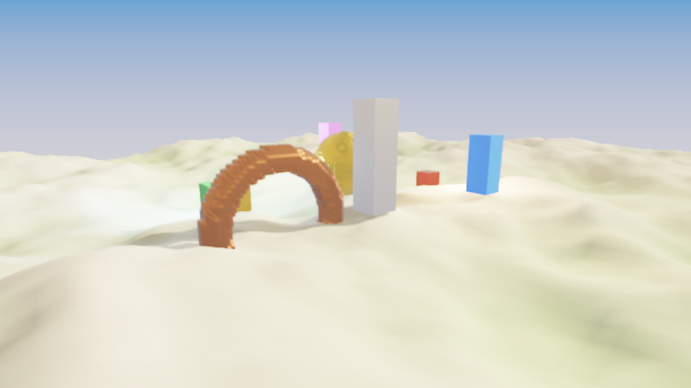
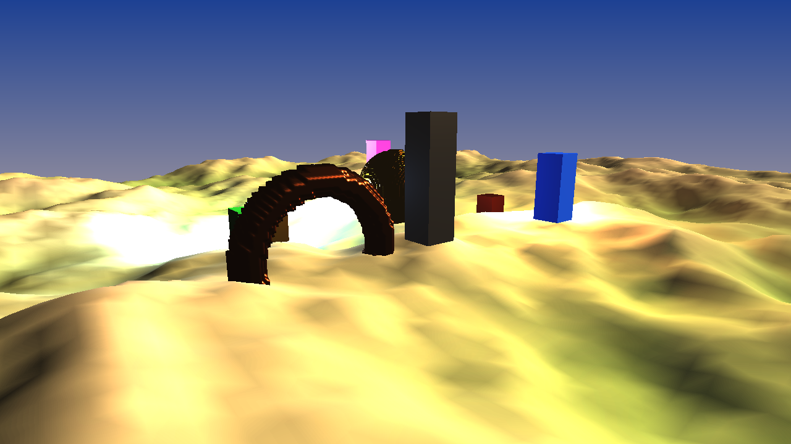

# Tutorial G3 — Deferred renderer (`fuhglgraphics::render::DeferredRenderer`)

> 🇩🇪 **Deutsche Version:** [docs/de/tutorials/g3_deferred_renderer.md](../../de/tutorials/g3_deferred_renderer.md)

**Goal:** render a scene with the new G3 deferred renderer — extended G-buffer (albedo+normal,
metallic/roughness/AO, HDR emissive, motion vectors, material ID), PBR lighting reusing
FuhGLCore lights/shadows/IBL, and the post chain TAA → FSR1-style upscale → ACES tonemap.

## Code

```cpp
#include <fuhglgraphics/graphics.hpp>
#include <fuhgl/fuhgl.hpp>
#include <fuhgl/render.hpp>

// 1) a current GL >= 3.3 context (fuhgl::Window; headless: FUHGL_BACKEND=surfaceless)
fuhgl::Window window;
window.create("demo", 1280, 720);

// 2) the renderer: output size + optional MSAA on the G-buffer
fuhglgraphics::render::DeferredRenderer renderer;
renderer.create(1280, 720, /*msaaSamples=*/0);
renderer.enableCsmShadows(2048, 4);        // shadows (FuhGLCore CascadeShadowMap)
renderer.setShadowSceneBounds({0, 4, 0}, 55.f);
renderer.setRenderScale(0.75f);            // render at 75%, FSR1-style EASU+RCAS upscale
renderer.setEffectEnabled(fuhglgraphics::render::Effect::Taa, true);     // default on
renderer.setEffectEnabled(fuhglgraphics::render::Effect::Tonemap, true); // default on

// 3) the scene (flat FuhGLCore SceneView — the G9 scene graph comes later)
fuhgl::render::SceneView scene;
scene.camera = &camera;                    // fuhgl::Camera, e.g. FirstPersonCamera
scene.width = 1280; scene.height = 720; scene.aspect = 1280.f / 720.f;
scene.items.push_back({&mesh, &material, model});          // fuhgl::render::DrawItem
scene.lights.push_back(fuhgl::render::Light::directional({-0.85f, -0.55f, -0.45f},
                                                          {1.f, 0.82f, 0.58f}, 3.4f));
scene.env = &environment;                  // optional IBL (fuhgl::render::Environment)

// 4) per frame — materialIds (optional, parallel to scene.items) go to the G-buffer
//    MaterialId attachment (used later by G8 decals)
std::vector<std::uint32_t> materialIds = {1, 2, 3};
renderer.render(scene, &materialIds);

// 5) results: renderer.output() is the LDR frame; the extended G-buffer is inspectable:
//    texAlbedo() texNormal() texPbr() texEmissive() texMotion() texMaterialId() texDepth()
//    and hdrTexture() is the lit HDR image before the post chain.
```

Effects are toggled per enum with capability gating (unsupported effects are refused with a
warning): `render::Effect::{Taa, Upscale, Tonemap, Msaa, Shadows, CsmShadows, Ibl}` —
`renderer.setEffectEnabled(...)`, `renderer.effectEnabled(...)`, `renderer.setAllEffects(...)`.

## Result

Rendered headless (surfaceless EGL) with the tool in `examples/screenshot` — full quality
(CSM shadows, IBL, TAA, ACES tonemap):


Same scene rendered at 60% internal resolution and upscaled with the FSR1-style EASU+RCAS
pass (`--scale 0.6`):



And with the post chain off (`--no-taa --no-tonemap --no-shadows --no-ibl`) — raw HDR clamp,
visible aliasing, no shadows — for comparison:



Reproduce: `cmake --build build --target fuhglgraphics_screenshot` then
`FUHGL_BACKEND=surfaceless ./build/examples/fuhglgraphics_screenshot --out shot.png --width 1280 --height 720 --frames 24`
(exit code 2 when no headless GL is available).
