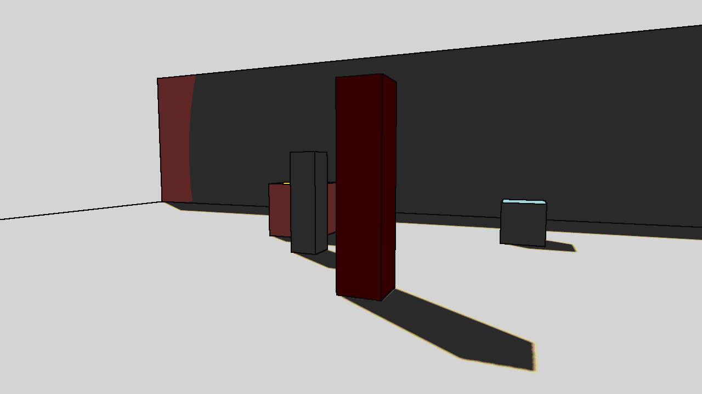
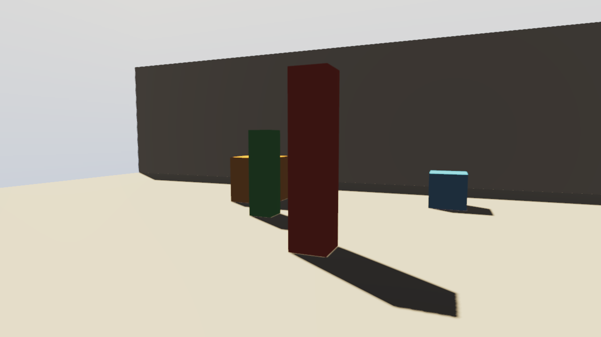
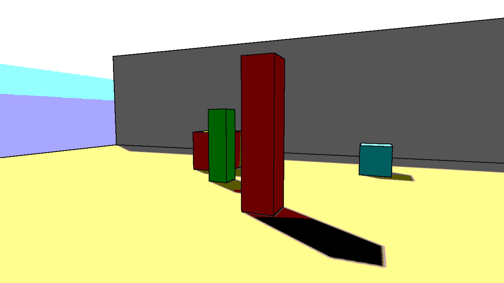

# Tutorial G40 — Custom post passes + comic look (`DeferredRenderer::PostPass`, `Effect::ComicLook`)

> 🇩🇪 **Deutsche Version:** [docs/de/tutorials/g40_custom_post_passes.md](../../de/tutorials/g40_custom_post_passes.md)

**Goal:** make the G3 deferred renderer's post chain extensible — register your own render
passes at runtime (e.g. a comic/cel look at the very end of the frame) and reuse the
results of earlier render stages (G-buffer, HDR chain, …) as pass inputs.

## How the post chain is structured

`DeferredRenderer` builds one `fuhgl::render::RenderGraph` in `createInternal()`:

```
gbuffer -> ssao/hbao -> lighting -> gi -> ssr -> water -> particles -> volumetric
        -> bloom -> flare -> taa -> upscale -> ca -> dof -> tonemap -> [your passes] -> comic -> present
```

- Every intermediate result is a **named graph resource** (`gAlbedo` … `gDepth`,
  `hdr`, `hdrG` … `hdrF`, `taa`, `up`, `ca`, `dof`, `ldr`, `comic`) — a texture you can
  declare as input of any pass or read from outside via `postGraph().texture("hdr")` /
  the typed accessors (`hdrTexture()`, `texNormal()`, `texSsao()`, …).
- The execution order follows from the resource dependencies (topological sort).
- `tonemap` writes the LDR resource `"ldr"`; custom passes chain after it; the built-in
  `"comic"` pass runs after your passes; a final no-output `"present"` pass copies the
  chain end into `output()`. (This `ldr` + `present` split is what makes "append a pass at
  the very end" work — a no-output pass without declared dependencies would run *before*
  the tonemap due to the LIFO tie-break of the order resolver.)

## Code

### 1) The built-in comic look (one line)

```cpp
renderer.setEffectEnabled(fuhglgraphics::render::Effect::ComicLook, true);
renderer.comicLevels         = 6.f;    // posterize color levels
renderer.comicEdgeStrength  = 1.4f;   // ink edge intensity
renderer.comicEdgeThreshold = 0.06f;  // edge response threshold
renderer.comicSaturation    = 1.35f;   // cel saturation boost
renderer.comicInkColor      = {0.04f, 0.03f, 0.05f};
// or per scene via scene::EffectParams (serialized with the scene, G19):
//   scene.root().effects.enable(render::Effect::ComicLook);
//   scene.root().effects.params.comicLevels = 6.f;
```

The pass runs last (after your custom passes): it posterizes the tonemapped LDR image and
draws ink outlines from a Sobel-style edge response on the G-buffer normal + depth
(silhouettes and geometric edges), reading `"@chain"`, `gNormal` and `gDepth`.

### 2) Your own post pass

```cpp
fuhgl::render::Material tintMat;                 // your own fullscreen material
// ... compile kFsVert-like vertex shader + a fragment shader sampling uSrc (unit 0) ...

fuhglgraphics::render::DeferredRenderer::PostPass tint;
tint.name   = "tint";
tint.inputs = {"@chain"};                        // output of the previous pass in the chain
tint.output = "tintOut";                         // owned output resource (required, unique)
tint.fn     = [&](fuhgl::render::RenderGraph::PassContext&) {
    // inputs are already bound at units 0..n-1 ("@chain" resolved at runtime) —
    // just set uniforms and draw the fullscreen triangle:
    renderer.drawFs(tintMat, [&](fuhgl::Program& p) {
        p.setUniform(p.uniformLocation("uSrc"), 0);
    });
};
renderer.addPostPass(tint);                      // rebuilds the graph when already created
// per frame:
renderer.setPostPassEnabled("tint", true);       // runtime toggle, no rebuild
```

Rules:

- `inputs` are bound to texture units `0..n-1` before `fn` runs; the placeholder `"@chain"`
  resolves to the output of the previous **enabled** pass (`"ldr"` for the first one), so
  disabling a pass mid-chain automatically falls through to its predecessor — no stale
  reads. Any other resource name (`"gNormal"`, `"hdrB"`, `"taa"`, …) works as-is.
- `output` is required and unique; `atOutputSize` (default true) selects output resolution
  vs. internal render-scale resolution, `outputFormat` defaults to `GL_RGBA16F`.
- `addPostPass`/`removePostPass` are structural: when the renderer is already `create()`d
  they rebuild all GL resources (same path as `resize()`); `setPostPassEnabled` only flips
  `RenderGraph::setPassEnabled` at runtime.
- Custom passes run **before** the built-in `comic` pass; disable `Effect::ComicLook` to
  have your own pass be the last one.

### 3) Reading stage results outside the graph

```cpp
renderer.render(scene, &materialIds);
const fuhgl::Texture* hdr = renderer.postGraph().texture("hdr"); // lit HDR before post
// typed accessors: texAlbedo() texNormal() texPbr() texEmissive() texMotion()
//                 texMaterialId() texDepth() hdrTexture() texSsao() reflectionTexture()
```

Owned resources are reallocated on `create()`/`resize()`/pass changes — fetch the texture
reference per frame, never cache it across a resize.

## Result

Rendered headless (surfaceless EGL) with `examples/comic_screenshot`
(`fuhglgraphics_comic_screenshot --out … [--no-comic] [--levels 6] [--edge 1.4]`;
the CI `docs-screenshots` job renders these into `docs/images/`):

| comic look on | off (plain PBR) | stronger (levels 3, edge 2.0) |
| --- | --- | --- |
|  |  |  |

## Tests

- `tests/test_postpass.cpp` — registry unit tests (no GL): add/remove/duplicates,
  runtime toggle, `Effect::ComicLook` name/capability mapping.
- `tests/gl_smoke_comic.cpp` — headless GL: comic on vs off must change the frame and
  produce ink pixels; a custom `addPostPass` pass must tint the frame, and disabling it
  must restore the exact base frame (the `@chain` fallback).
