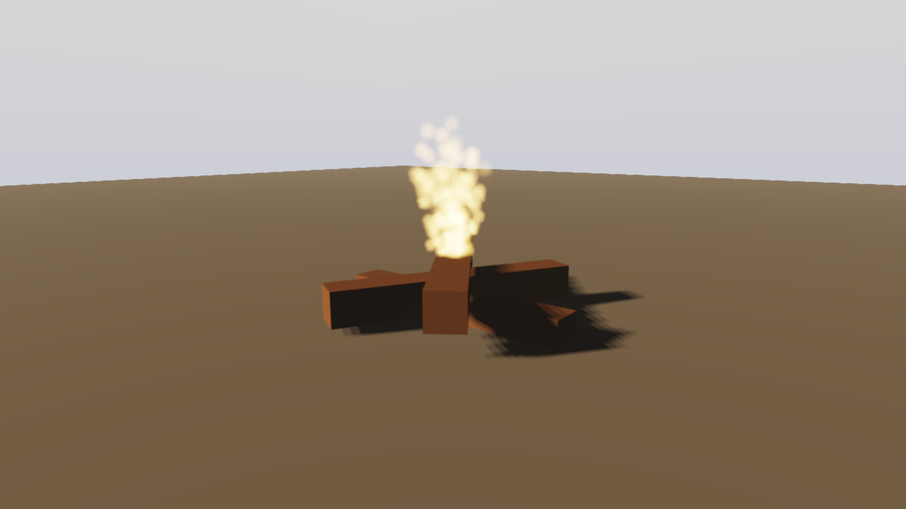
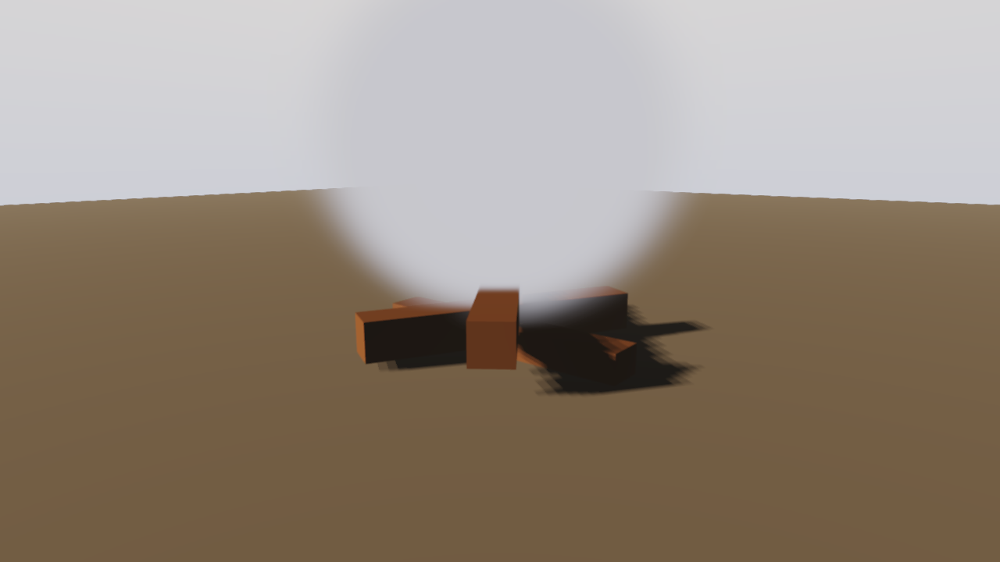
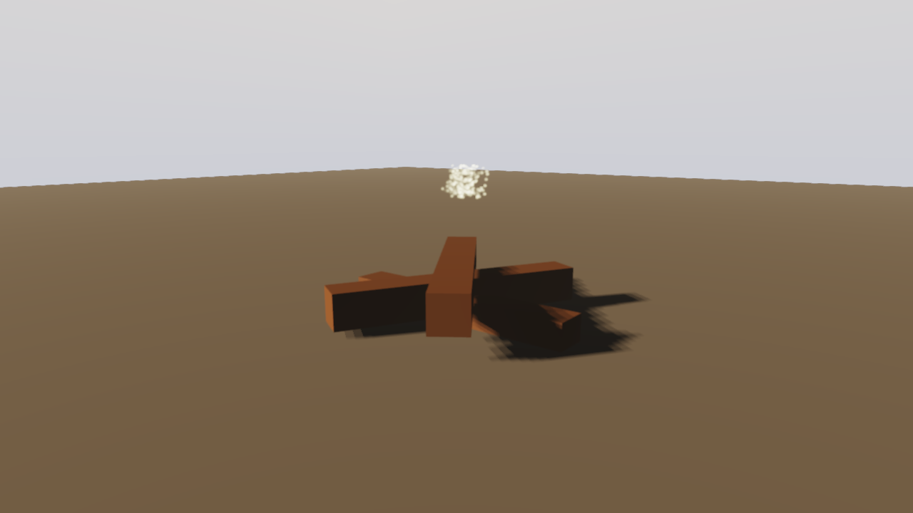
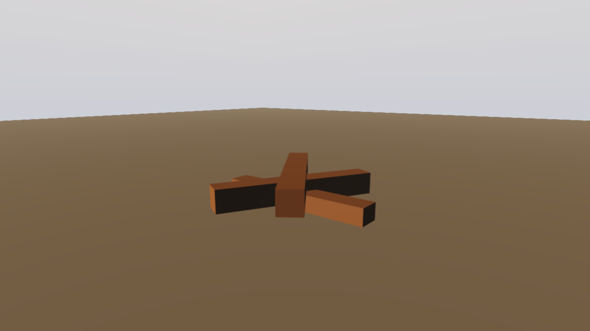

# Tutorial G5 — GPU particles (`fuhglgraphics::particles::ParticleSystem`)

> 🇩🇪 **Deutsche Version:** [docs/de/tutorials/g5_particles.md](../../de/tutorials/g5_particles.md)

**Goal:** a GPU particle system on FuhGLCore's compute pattern (like `GpuCuller`, F34):
emitter + integrate compute shaders over an SSBO, rendered as instanced camera-facing
billboards through the G3 deferred renderer's "particles" post pass — with a CPU fallback
on GL 3.3–4.2.

## Design

- `particles::EmitterConfig` — position, direction, speed/spread cone, rate (particles/s),
  lifetime, size + growth, color/alpha, gravity, wind, drag, seed, blend mode
  (additive for sparks/fire, alpha for smoke).
- `particles::ParticleSystem` (PIMPL, movable). `create(maxParticles, cfg)` needs a current
  GL context: on **GL >= 4.3** (`system.gpu() == true`) it builds one SSBO of particle structs
  (`vec4 pos+size, vel+life, color+alpha, maxLife+seed`), an atomic-counter buffer, the
  emit/integrate compute shaders and an instanced-billboard program — the SSBO is at the
  same time the divisor-1 instance-attribute buffer (locations 4..7), exactly like
  `GpuCuller`. On **GL 3.3–4.2** the identical math runs on the CPU (`particles::CpuSim`,
  pure and unit-tested) and alive particles are streamed into a dynamic VBO per frame.
- `update(dt)` emits (fractional rate accumulator) and integrates (gravity/wind/drag/aging,
  size growth). `aliveCount()` is exact on CPU and read back from the GPU atomic alive
  counter.
- Rendering: the G3 `DeferredRenderer` gained a **"particles" post pass** between lighting
  and TAA (graph resource `hdr` → `hdrP`): a copy of the HDR image, then each system's
  billboards blended (ONE,ONE additive or SRC_ALPHA) with a radial falloff, a life fade and
  a **soft-particle depth fade** against the G-buffer depth (`uSceneDepth`). Toggle with
  `render::Effect::Particles`.

## Code (as a G9 component)

```cpp
#include <fuhglgraphics/graphics.hpp>

fuhglgraphics::scene::Scene scene;
auto& em = scene.root().createChild("fire").attach<fuhglgraphics::scene::ParticleEmitterComponent>();
em.config.position = {0.f, 0.35f, 0.f};
em.config.direction = {0.f, 1.f, 0.f};
em.config.speed = 1.6f;  em.config.rate = 350.f;   // embers/s
em.config.lifetime = 0.9f; em.config.size = 0.07f;
em.config.color = {1.0f, 0.55f, 0.15f};
em.config.blend = fuhglgraphics::particles::BlendMode::Additive;
em.system.create(8192, em.config);          // needs a current GL context (GPU on >= 4.3)

// per frame:
scene::FrameData frame;
scene.fillFrame(frame, nullptr, 1280, 720); // collects em.system into frame.particleSystems
frame.effects.enable(fuhglgraphics::render::Effect::Particles);
frame.effects.applyTo(renderer);
for (auto& c : scene.root().children())
    if (auto* e = c->find<fuhglgraphics::scene::ParticleEmitterComponent>())
        e->system.update(dt);
renderer.render(frame.view, &frame.materialIds, &frame.castShadow, &frame.particleSystems);
```

## Demo + result

`examples/particles_screenshot` builds a campfire scene (log pile, sun, sky cubemap, CSM
shadows via the F45 shadow kit, god rays) with three emitters, selectable via
`--kind fire|smoke|pollen|all`, and writes a PNG headless:

```bash
cmake --build build --target fuhglgraphics_particles_screenshot
FUHGL_BACKEND=surfaceless ./build/examples/fuhglgraphics_particles_screenshot \
    --out fire.png --kind fire --width 1280 --height 720 --frames 24
```

Rendered headless (surfaceless EGL, Mesa llvmpipe, GL 4.5 → compute path active,
`gpu=1`, ~300 alive embers):



Smoke plume (alpha blend, expanding billboards, `--kind smoke`):



Pollen/dust motes drifting through the god rays (`--kind pollen`):



Same scene with particles/shadows/rays off (`--no-particles --no-shadows --no-rays`) for
comparison:



## Tests

- `tests/test_particles.cpp` (label `unit`, no GL): `CpuSim` emission rate + fractional
  accumulator, integration (gravity/wind/drag/aging/size growth), compaction of dead
  particles, determinism per seed.
- `tests/gl_smoke_particles.cpp` (label `gl_context`, skips with 77 without GL >= 3.3):
  creates a system on the GL context, checks `gpu()` against the GL version, simulates 1 s
  (`aliveCount() > 50`), renders through the G3 renderer with and without the system and
  asserts the emitter's screen region gets brighter + no GL error.
