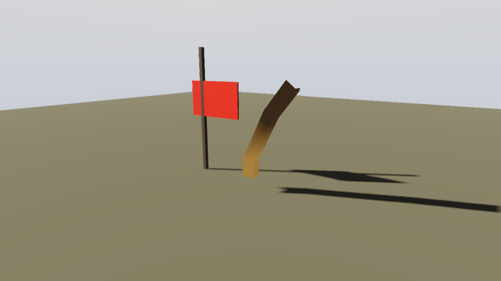
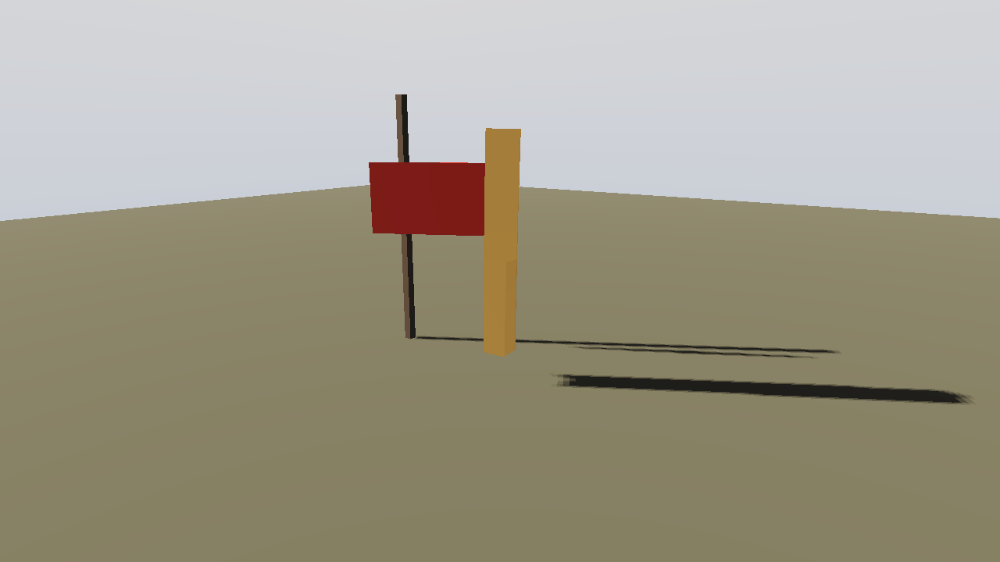
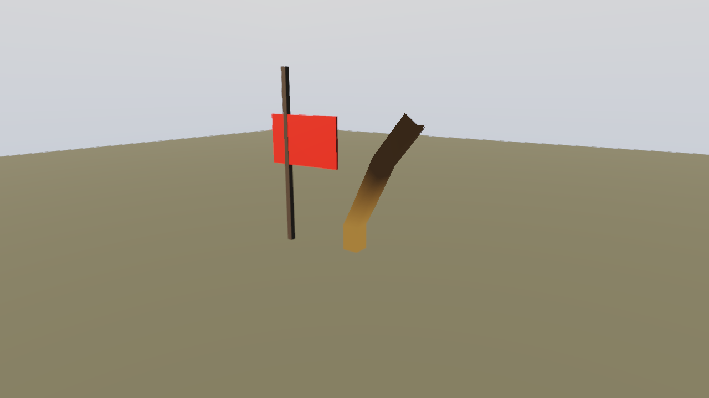

# Tutorial G6 — Animation & skinning (`fuhglgraphics::anim`)

> 🇩🇪 **Deutsche Version:** [docs/de/tutorials/g6_animation.md](../../de/tutorials/g6_animation.md)

**Goal:** keyframe animation of G9 scene nodes plus skeletal skinning — `anim::AnimationPlayer`
(TRS clips, loop modes, slerp) and `anim::Skeleton` + CPU skinning (`skinMeshCpu`) with the
joint matrix palette. glTF animations/skins are parsed by the G4 loader.

## Design

- `anim::AnimationClip` / `anim::TrsChannel` — keyframe channels per **node name**
  (times + translations / rotations / scales; sampled with lerp and `fuhgl::math::slerp`).
- `anim::AnimationPlayer` — `play(name, LoopMode::Once|Loop|PingPong, speed)`, `update(dt)`,
  `applyTo(scene)` writes the sampled TRS into the named `scene::Node`s (call before
  `Scene::fillFrame()`). Pure CPU — unit-testable. As a G9 component:
  `scene::AnimationComponent` holds a player.
- Skeletal skinning (CPU path, allowed by the requirement "CPU or GPU"): `anim::Skeleton`
  holds joint node indices + inverse bind matrices; `updatePalette(jointNodePtrs)` computes
  the per-frame palette `jointWorld * inverseBind`; `skinMeshCpu()` deforms the bind-pose
  `MeshData` (+ `SkinWeights` from JOINTS_0/WEIGHTS_0) into a dynamic mesh.
- glTF (G4 extension): `animations[]` (channels/samplers → clips) and `skins[]` (joints +
  inverseBindMatrices) are parsed into `GltfAsset::animations/skins`; `instantiateGltf()`
  fills `GltfGpuResources::player` (clips), `skeletons`, `nodePtrs` and `skinnedMeshes`
  (bind pose + weights per skinned primitive).

## Code

```cpp
#include <fuhglgraphics/graphics.hpp>

fuhglgraphics::scene::Scene scene;
auto& joint1 = scene.root().createChild("joint0").createChild("joint1");

fuhglgraphics::anim::AnimationClip bend;
bend.name = "bend"; bend.duration = 1.2f;
fuhglgraphics::anim::TrsChannel ch;
ch.nodeName = "joint1";
ch.times = {0.f, 0.6f, 1.2f};
ch.rotations = {fuhgl::math::Quat{0,0,0,1}, fuhgl::math::fromAxisAngle(-1.05f, {0,0,1}),
                fuhgl::math::Quat{0,0,0,1}};
bend.channels.push_back(ch);

fuhglgraphics::anim::AnimationPlayer player;
player.addClip(bend);
player.play("bend", fuhglgraphics::anim::LoopMode::PingPong);

fuhglgraphics::anim::Skeleton skeleton;
skeleton.jointNodes = {0, 1};
skeleton.inverseBindMatrices = {fuhgl::math::Mat4{}, fuhgl::math::Mat4{}};

// per frame:
player.update(dt);
player.applyTo(scene);                       // writes TRS into the named nodes
scene::FrameData frame;
scene.fillFrame(frame, nullptr, 1280, 720);
skeleton.updatePalette({&joint0, &joint1}); // palette = jointWorld * IBM
fuhglgraphics::anim::skinMeshCpu(armBase, armWeights, skeleton.palette, skinned);
armMesh.setMeshData(skinned);                // dynamic mesh, rendered by the G3 pass
renderer.render(frame.view, &frame.materialIds, &frame.castShadow);
```

## Demo + result

`examples/animation_screenshot` builds a 2-joint robot arm (skinned box strip, CPU palette)
that bends via a pingpong clip, plus a flag on a pole waving via a looped TRS channel —
rendered headless with the G3 renderer (PCSS shadows, sky cubemap, god rays):

```bash
cmake --build build --target fuhglgraphics_animation_screenshot
FUHGL_BACKEND=surfaceless ./build/examples/fuhglgraphics_animation_screenshot \
    --out bend.png --time 0.55 --width 1280 --height 720 --frames 16
```

Arm bent mid-clip (t = 0.55 s, `--time 0.55`), flag waving, PCSS shadows on the ground:



Same clip at the pingpong turning point (t = 1.2 s) — the arm is straight again:



Same pose with shadows/rays off (`--no-shadows --no-rays`) for comparison:



## Tests

- `tests/test_anim.cpp` (label `unit`, no GL): channel sampling (lerp/slerp/clamping),
  player loop modes (Once/Loop/PingPong), `applyTo` node map, `skinMeshCpu` (identity
  palette = bind pose; translated joint moves weighted vertices).
- `tests/test_io.cpp`: the generated glTF fixture now also carries an animation clip and a
  skin (JOINTS_0/WEIGHTS_0 + inverseBindMatrices) — parsing is asserted.
- `tests/gl_smoke_anim.cpp` (label `gl_context`, skips with 77): instantiates the fixture,
  plays "spin", renders two frames at t=0/t=1 (images must differ), checks the animated
  node's pose and CPU-skinned vertex positions.
