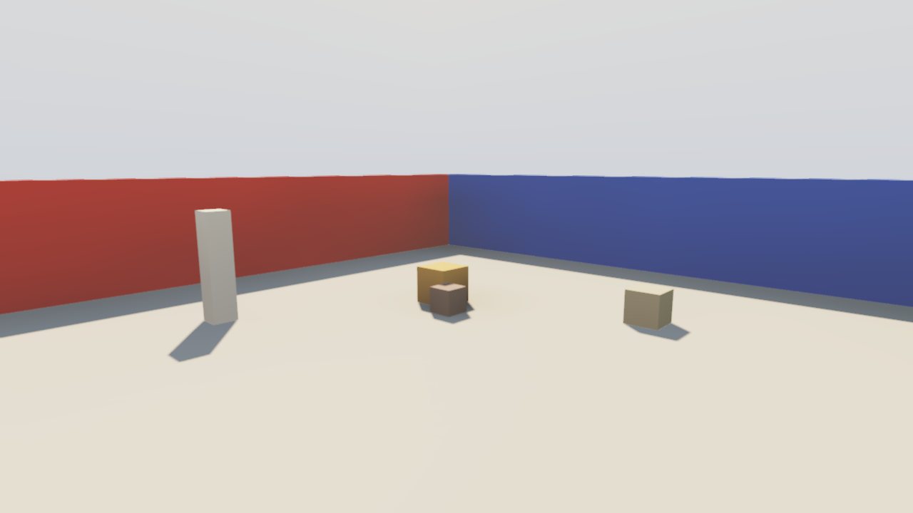
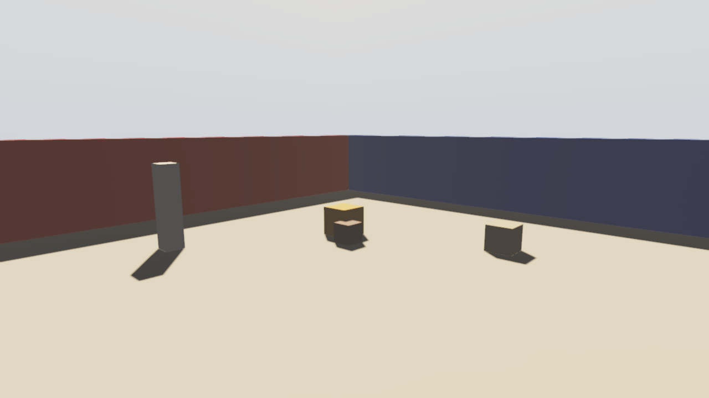
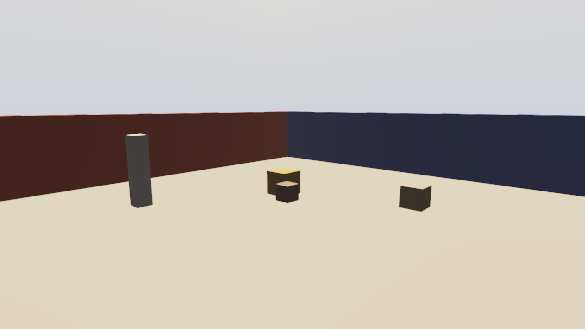

# Tutorial G7 — Light probes (SH irradiance GI, `fuhglgraphics::probes`)

> 🇩🇪 **Deutsche Version:** [docs/de/tutorials/g7_light_probes.md](../../de/tutorials/g7_light_probes.md)

**Goal:** diffuse indirect light (color bleeding) via a grid of SH (L2) irradiance
light probes — baked on the CPU, sampled with trilinear interpolation in the G3 lighting
pass on the GL 3.3 baseline (3D textures). Toggle: `render::Effect::LightProbes`.

## Design

- `probes::LightProbeGrid` — a regular grid of probes over an AABB (`create(nx, ny, nz,
  min, max)`; probes sit on the grid nodes, `cell()` = spacing). Each probe holds 9 RGB
  SH L2 coefficients (`Sh9`, order Y00, Y1-1, Y10, Y11, Y2-2, Y2-1, Y20, Y21, Y22).
- **Bake (CPU, no GL):** `bake(BakeInput)` shoots a fibonacci sphere of rays per probe
  against a world-space triangle soup (`ProbeTriangle{a,b,c,albedo,emissive}`).
  Miss rays take `skyRadiance(dir)`; hits gather one bounce —
  `albedo/π * incoming * cos` where `incoming` = emissive + sky (visibility-tested) +
  each light with a shadow-ray occlusion test. The samples are projected onto SH L2
  (`shProject`); `shIrradiance(c, n)` evaluates `E(n) = Σ A_l c_lm Y_lm(n)`
  (constant radiance L ⇒ E = πL — asserted in the unit tests).
- **GPU (GL 3.3):** `ensureUploaded()` packs the 27 floats per probe into seven RGBA16F
  3D textures (units 17–23); hardware-linear 3D sampling interpolates the coefficients
  trilinearly across the grid. The renderer uploads lazily on the first
  `render(..., lightProbes)` with the effect enabled.
- **Lighting pass:** with `Effect::LightProbes` on, the diffuse ambient is replaced by
  `kD * albedo * (E(N)/π) * ao * lightProbeStrength` (IBL keeps its specular part), so
  colored walls bleed into shadowed floor.
- **G9:** `scene::LightProbeComponent` owns the grid; `Scene::fillFrame()` puts it into
  `FrameData::lightProbes`; `renderer.render(view, &materialIds, &castShadow,
  &particleSystems, frame.lightProbes)`.

## Code

```cpp
#include <fuhglgraphics/graphics.hpp>

fuhglgraphics::scene::Scene scene;
// ... build meshes; keep a world-space triangle soup for the bake ...
fuhglgraphics::probes::BakeInput bake;
bake.triangles = soup;                                  // probes::ProbeTriangle list
bake.lights = {fuhgl::render::Light::directional(sunDir, sunColor, 3.f)};
bake.skyRadiance = [](const fuhgl::math::Vec3& d) {     // sky + sun disk
    return fuhgl::math::lerp(skyHorizon, skyTop, fuhgl::math::clamp(d.y, 0.f, 1.f));
};

auto& pc = scene.root().createChild("probes").attach<fuhglgraphics::scene::LightProbeComponent>();
pc.grid.create(9, 4, 9, {-11.5f, 0.05f, -11.5f}, {11.5f, 3.8f, 11.5f});
pc.grid.bake(bake);                                     // CPU — no GL context needed

scene.root().effects.enable(fuhglgraphics::render::Effect::LightProbes);
// per frame:
fuhglgraphics::scene::FrameData frame;
scene.fillFrame(frame, nullptr, 1280, 720);             // frame.lightProbes = &pc.grid
frame.effects.applyTo(renderer);
renderer.render(frame.view, &frame.materialIds, &frame.castShadow, &frame.particleSystems,
                frame.lightProbes);
```

## Demo + result

`examples/probes_screenshot` builds a courtyard with a red, a green and a blue wall,
crates and a low warm sun, bakes a 9×4×9 probe grid and renders headless with the G3
renderer (PCSS shadows, sky cubemap, god rays):

```bash
cmake --build build --target fuhglgraphics_probes_screenshot
FUHGL_BACKEND=surfaceless ./build/examples/fuhglgraphics_probes_screenshot \
    --out probes.png --width 1280 --height 720 --frames 16
```

With light probes (`Effect::LightProbes`): the shadowed floor receives indirect light and
the wall colors bleed into it:



Same scene with `--no-probes` — flat ambient, hard black shadows:



Without shadows and god rays (`--no-probes --no-shadows --no-rays`) for comparison:



## Tests

- `tests/test_probes.cpp` (label `unit`, no GL): SH basis/projection/irradiance
  (constant radiance ⇒ E = πL), ray-triangle intersection, grid layout, CPU bake —
  sky over a floor (more irradiance from above), a closed box with one emissive red wall
  (directional SH: strong red toward the wall, dark opposite side) and an empty closed
  box (zero).
- `tests/gl_smoke_probes.cpp` (label `gl_context`, skips with 77): bakes a grid over a
  colored-wall corner, uploads it (3D texture ids != 0), renders with the effect on vs
  off — the frames differ and the frame gets brighter with probes; no GL error.
