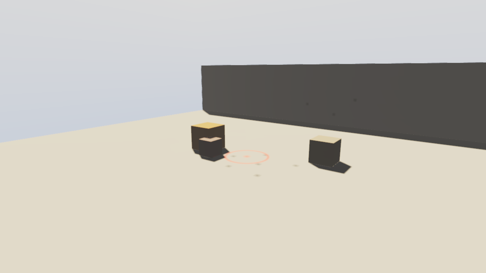
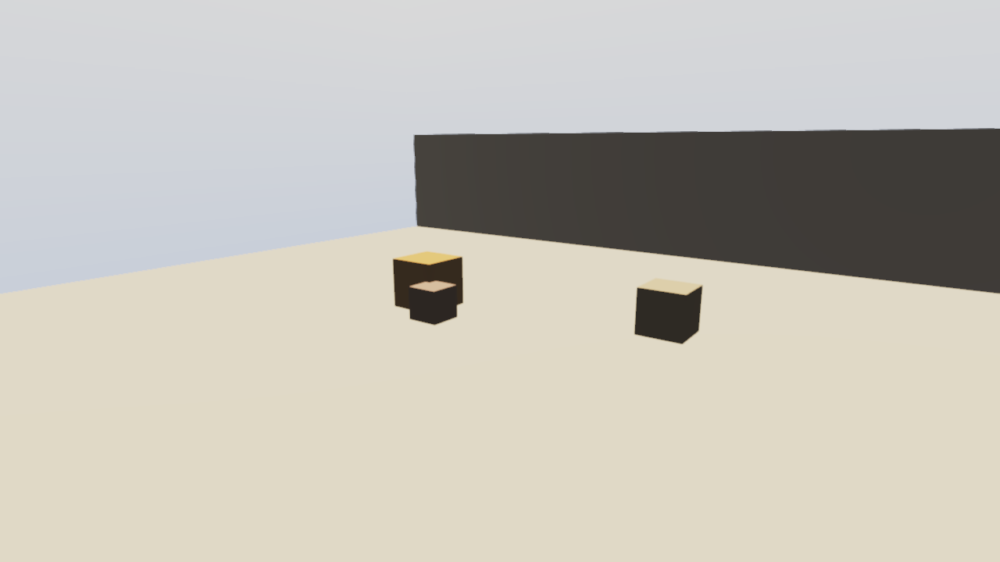

# Tutorial G8 — Deferred decals (`fuhglgraphics::render::Decal`)

> 🇩🇪 **Deutsche Version:** [docs/de/tutorials/g8_decals.md](../../de/tutorials/g8_decals.md)

**Goal:** projected decals (bullet holes, footprints, markings) written into the G3
G-buffer — the MaterialId attachment (G3/G9) gates which surfaces receive a decal.
Toggle: `render::Effect::Decals`.

## Design

- `render::Decal` (plain data, `render/decals.hpp`): an oriented box (`world` × unit box
  scaled by `halfExtents`) with `albedo` × optional `albedoTexture`, optional `normalMap`,
  `opacity` and a `materialIdMask` — the decal applies where `(materialId & mask) != 0`.
  `render::decalProject()` is the pure CPU mirror of the projection (unit-tested).
- **Renderer pass** (`DeferredRenderer::drawDecals`, runs between the G-buffer geometry
  pass and the lighting pass): each decal box is drawn depth-tested (front faces, depth
  `LESS`, no depth writes) into attachments 0 (albedo) + 1 (normal) only. The fragment
  shader reconstructs the G-buffer world position from the depth attachment, keeps pixels
  whose surface lies inside the box and matches the material-ID mask, projects onto the
  dominant face axis of the surface normal (decal-local UV), and mixes the decal
  albedo/normal in. Sorted back-to-front, capped at `render::kMaxDecals` (16, farthest
  dropped with a one-time warning). With MSAA the pass runs after the resolve.
- **G9:** `scene::DecalComponent` holds one `render::Decal`; `fillFrame()` sets its world
  matrix from the node and appends it to `FrameData::decals`; pass `&frame.decals` to
  `renderer.render(..., &frame.decals)`.

## Code

```cpp
#include <fuhglgraphics/graphics.hpp>

fuhglgraphics::scene::Scene scene;
// ground quad with materialId = 1, wall with materialId = 2, ...

auto& node = scene.root().createChild("bulletHole");
node.translation = {-2.f, 0.02f, -1.2f};
auto& dc = node.attach<fuhglgraphics::scene::DecalComponent>();
dc.decal.halfExtents = {0.16f, 0.05f, 0.16f};  // must straddle the surface plane
dc.decal.albedoTexture = &bulletTex;            // RGBA, alpha = decal coverage
dc.decal.opacity = 0.95f;
dc.decal.materialIdMask = 1u;                   // ground only

scene.root().effects.enable(fuhglgraphics::render::Effect::Decals);
// per frame:
fuhglgraphics::scene::FrameData frame;
scene.fillFrame(frame, nullptr, 1280, 720);
frame.effects.applyTo(renderer);
renderer.render(frame.view, &frame.materialIds, &frame.castShadow, &frame.particleSystems,
                frame.lightProbes, &frame.decals);
```

## Demo + result

`examples/decals_screenshot` builds a plaza (ground = material ID 1, back wall = ID 2,
crates = ID 3) with 8 bullet-hole decals on the ground, 3 on the wall (mask 2) and one big
red ring marking, rendered headless with the G3 renderer (PCSS shadows, sky cubemap,
god rays, fog):

```bash
cmake --build build --target fuhglgraphics_decals_screenshot
FUHGL_BACKEND=surfaceless ./build/examples/fuhglgraphics_decals_screenshot \
    --out decals.png --width 1280 --height 720 --frames 16
```

With decals (`Effect::Decals`) — red ring marking + bullet holes on ground and wall:



Same scene with `--no-decals`:


Without decals/shadows/rays (`--no-decals --no-shadows --no-rays`) for comparison:



## Tests

- `tests/test_render.cpp` (label `unit`, no GL): `Effect::Decals` in the effect registry
  (kEffectCount, effectName) and `render::decalProject` — box containment, dominant-axis
  UV mapping (ground vs wall), rotated/translated decal boxes.
- `tests/gl_smoke_decals.cpp` (label `gl_context`, skips with 77): ground (ID 1) + crate
  (ID 2) with a red decal box, rendered with `Effect::Decals` on vs off — the center gets
  red only when enabled, and a mask targeting ID 2 leaves the ground unchanged; no GL
  error.
