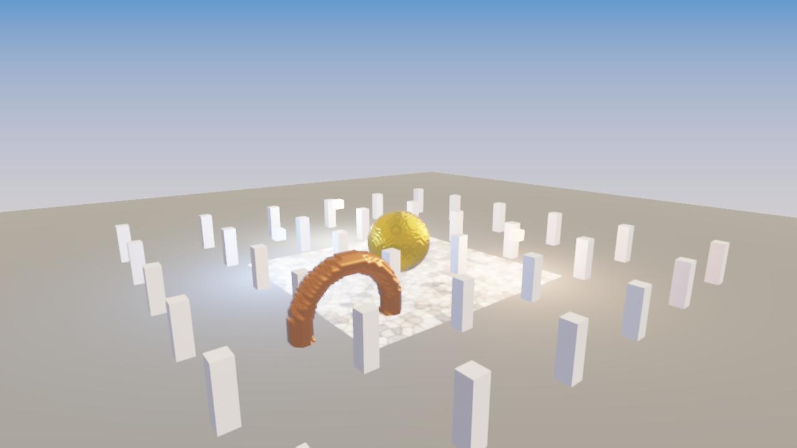
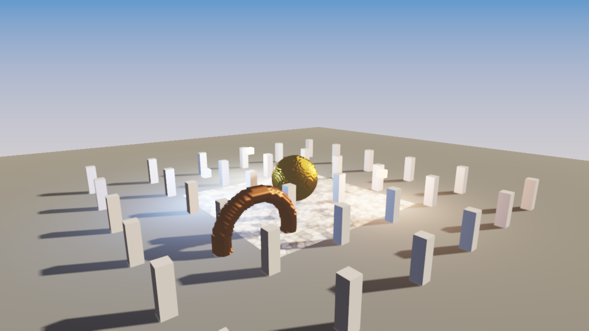
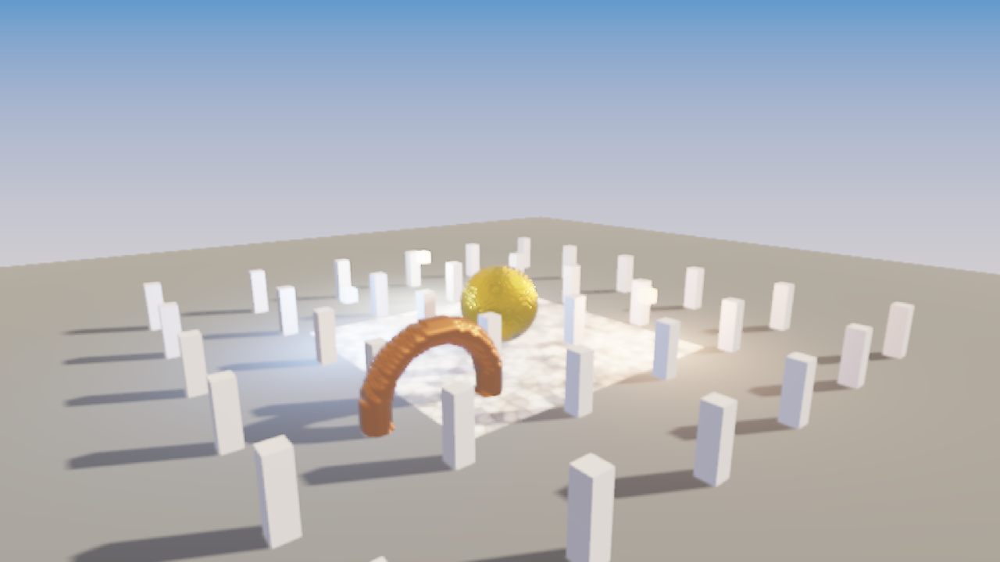
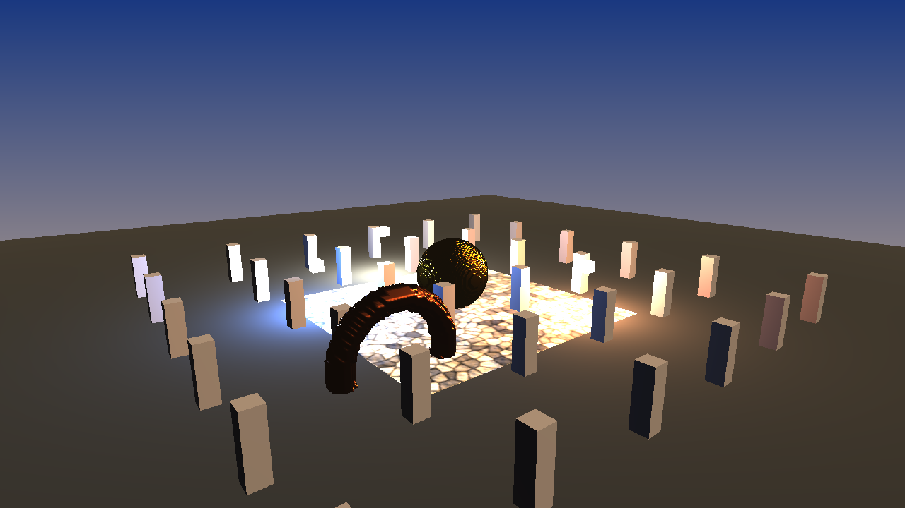
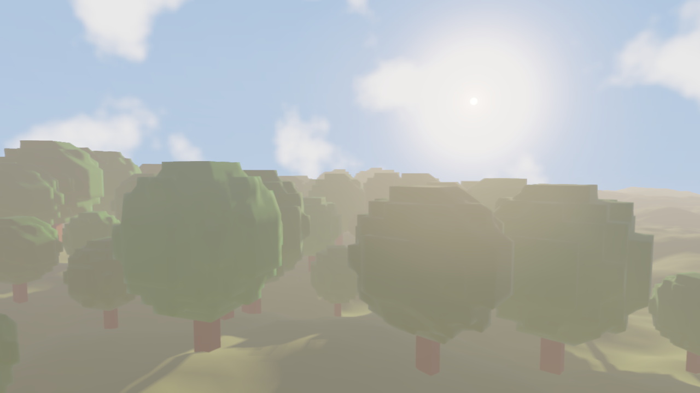
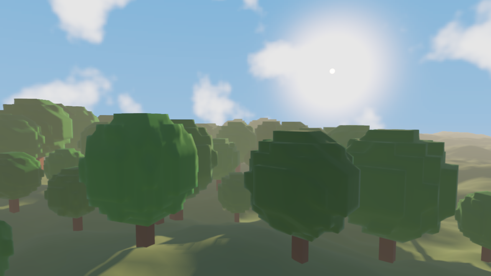
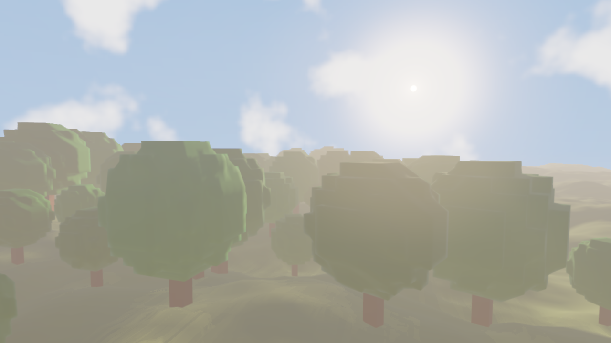
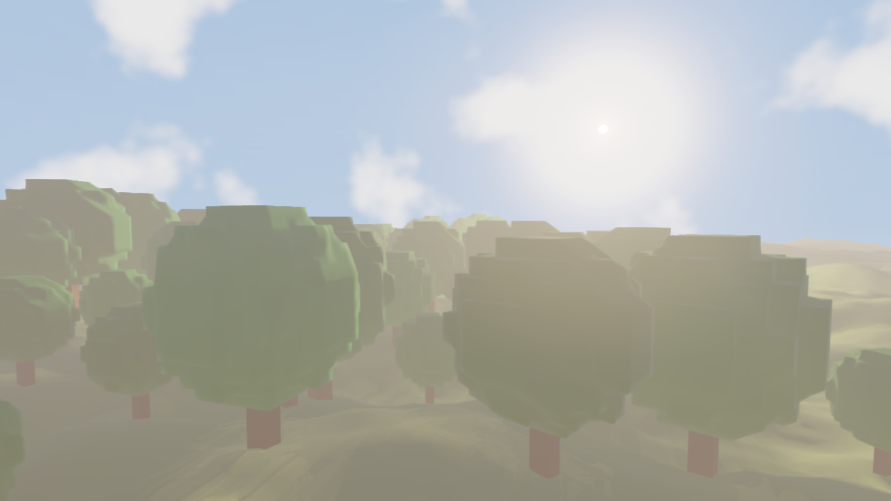

# Tutorial G9 — Scene graph (`fuhglgraphics::scene::Scene`)

> 🇩🇪 **Deutsche Version:** [docs/de/tutorials/g9_scene_graph.md](../../de/tutorials/g9_scene_graph.md)

**Goal:** build a scene as a graph of `Node`s with components (mesh / light / camera),
per-node effect lists + parameters, a per-node instancing property and per-mesh textures
(albedo + normal map) — fill a `FrameData` and render it with the G3 deferred renderer.

## Code

```cpp
#include <fuhglgraphics/graphics.hpp>
#include <fuhgl/fuhgl.hpp>
#include <fuhgl/render.hpp>

fuhglgraphics::scene::Scene scene;

// every node carries an Effects list + parameters — merged (union of the lists,
// last-visited node's params win) over all nodes per frame
scene.root().effects.enable(fuhglgraphics::render::Effect::Taa);
scene.root().effects.enable(fuhglgraphics::render::Effect::CsmShadows);
scene.root().effects.params.exposure = 1.15f;

// the camera can come from a CameraComponent (fillFrame with camera = nullptr)
scene.root().createChild("camera").attach<fuhglgraphics::scene::CameraComponent>().camera = &cam;

// a node can hold SEVERAL meshes — one MeshEntry each with its own local offset,
// material parameters, textures, castShadow flag and material ID
fuhglgraphics::scene::Node& hero = scene.root().createChild("hero");
auto& mc = hero.attach<fuhglgraphics::scene::MeshComponent>();
auto& sphereEntry = mc.addMesh(&sphere);
sphereEntry.albedo = {0.83f, 0.66f, 0.24f};
sphereEntry.metallic = 1.f; sphereEntry.roughness = 0.22f;
sphereEntry.materialId = 2; sphereEntry.castShadow = true;
auto& torusEntry = mc.addMesh(&torus);
torusEntry.localOffset = fuhgl::math::translate({-6.5f, -1.3f, 4.5f});
torusEntry.normalMap = &normalTex;   // albedoTexture + normalMap per mesh entry

// instancing as a node property: one instanced draw call for the whole grid
fuhglgraphics::scene::Node& pillars = scene.root().createChild("pillars");
pillars.instancing.enabled = true;
pillars.instancing.count = 36;                          // 6x6
pillars.instancing.layout = fuhglgraphics::scene::InstanceLayout::Grid;
pillars.instancing.extent = {26.f, 0.f, 26.f};
pillars.attach<fuhglgraphics::scene::MeshComponent>().addMesh(&pillar);

// lights are components too — position/direction follow the node's world transform
scene.root().createChild("sun").attach<fuhglgraphics::scene::LightComponent>().light =
    fuhgl::render::Light::directional({-0.85f, -0.55f, -0.45f}, {1.f, 0.82f, 0.58f}, 3.4f);

// per frame:
fuhglgraphics::scene::FrameData frame;
scene.fillFrame(frame, /*camera=*/nullptr, 1280, 720);  // world matrices + AABBs + frustum culling
frame.effects.applyTo(renderer);                        // merged effects -> G3 DeferredRenderer
renderer.render(frame.view, &frame.materialIds, &frame.castShadow);
```

`Scene::fillFrame()` traverses the graph (frustum culling against world AABBs), appends draw
items and lights, fills the parallel `materialIds` / `castShadow` vectors and merges all node
`Effects`. Components are a polymorphic list: `node.attach<T>(args...)`, `node.find<T>()`,
`node.findAll<T>()`, `node.detach(component)`.

## Result

Rendered headless (surfaceless EGL) with the tool in `examples/scene_screenshot` — the demo
scene graph (textured plaza with normal map, hero node with two meshes, 6×6 instanced pillar
grid, lamp + sun light nodes) with all effects on (CSM shadows, IBL, TAA, ACES tonemap):


The per-node effect list drives the renderer per frame — the same scene with shadows off:



… with IBL off (flat ambient instead of the environment cubemap):



… rendered at 60% internal resolution and upscaled by the FSR1-style EASU+RCAS pass
(`--scale 0.6`):



… and with all effects off (`--no-taa --no-tonemap --no-upscale --no-shadows --no-ibl`) —
raw clamp, visible aliasing, no shadows — for comparison:



Reproduce: `cmake --build build --target fuhglgraphics_scene_screenshot` then
`FUHGL_BACKEND=surfaceless ./build/examples/fuhglgraphics_scene_screenshot --out shot.png --width 1280 --height 720 --frames 24 [--no-shadows] ...`
(exit code 2 when no headless GL is available).

## Landscape with cloud sky, sun, fog and god rays

`examples/landscape_screenshot` builds a bigger G9 landscape: a heightmap terrain with
~170 tree nodes (each holding **two mesh entries** — trunk + foliage), a procedural fBm
**cloud sky cubemap** (`renderer.setSkyCubemap`, also baked as the IBL environment), a low
warm sun (sun disk from the directional light), distance fog and **god rays**
(`renderer.godRays`, occlusion-tested against the G-buffer depth in the tonemap pass):



Same scene with the god rays off (`--no-rays`) — the light shafts toward the sun disappear:



Reproduce: `cmake --build build --target fuhglgraphics_landscape_screenshot` then
`FUHGL_BACKEND=surfaceless ./build/examples/fuhglgraphics_landscape_screenshot --out shot.png --width 1280 --height 720 --frames 24 [--no-rays] [--no-fog] [--no-clouds] [--no-shadows] [--no-ibl]`.

## Landscape on the FuhGLCore shadow kit (F45/F46)

The G3 renderer's shadows run on FuhGLCore's shadow kit: cascade light VPs are texel-snapped
(`shadowSnapToTexels`, no more swimming at the splits), cascades cross-fade near the split
planes (`shadowCascadeBlend`), and the sampling filter is selectable per frame via
`--shadow-filter pcf3x3|poisson|pcss|vsm` (`EffectParams::shadowFilter` →
`DeferredRenderer::setShadowFilter`; VSM renders RGBA32F moments into an extra attachment).
PCSS gives soft, penumbra-wide tree shadows (`--light-size`):



VSM (variance shadow map, Chebyshev-filtered) and the legacy hard 3x3 PCF for comparison:


`--point-shadows` adds a warm lamp point light whose cube shadow map (F46 `CubeShadowMap`)
and `--contact-shadows` (screen-space raymarch against the G-buffer depth) darken the
lamp's surroundings contact-accurately:



Reproduce: add `[--shadow-filter pcss] [--light-size 0.8] [--cascade-blend 0.25] [--point-shadows] [--contact-shadows] [--no-snap]` to the command above.
